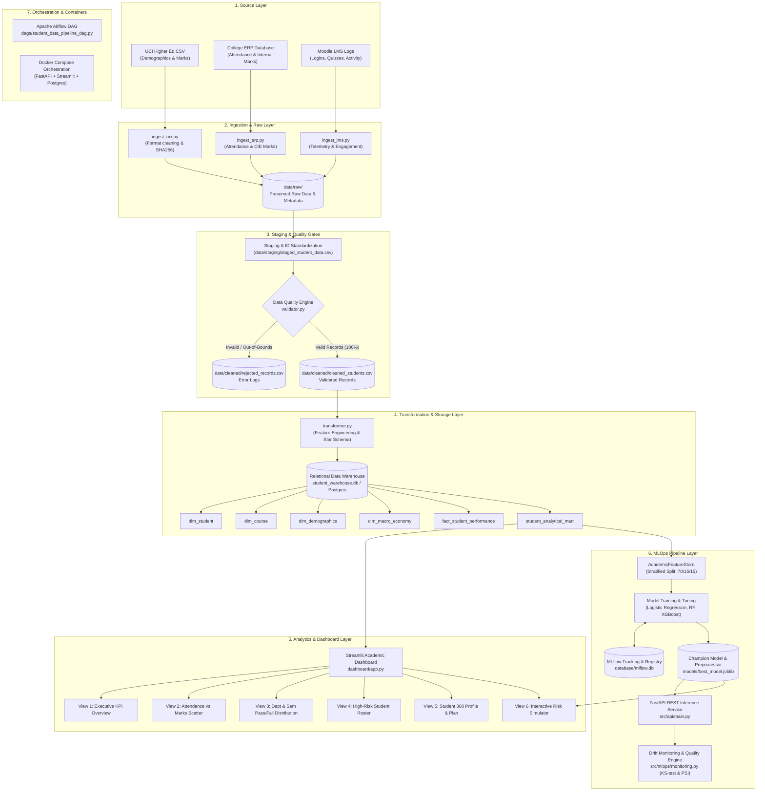
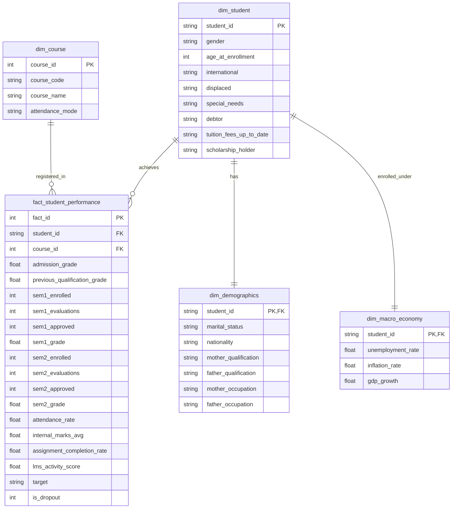

# System Architecture & Pipeline Flow Specification

## 1. Architectural Overview

The **Student Performance and Dropout-Risk Prediction System** is structured as an end-to-end, multi-tier data engineering and MLOps platform. The architecture transitions raw institutional data across seven decoupled layers:

1. **Source Layer**: Heterogeneous administrative sources (UCI historical dataset, College ERP exports, Moodle LMS activity logs).
2. **Ingestion Layer**: Python/Pandas extraction connectors with cryptographic SHA-256 auditing and metadata logging.
3. **Raw / Staging Layer**: Raw preservation and student ID standardization across sources (`STU_10000+`).
4. **Validation & Quality Layer**: Business rule engine checking boundary conditions, logging rejected records, and eliminating duplicates.
5. **Transformation & Storage Layer**: Star Schema dimension and fact tables loaded into a PostgreSQL / SQLite Relational Data Warehouse.
6. **Analytics Layer**: Denormalized `student_analytical_mart` serving the interactive Streamlit analytics dashboard.
7. **MLOps Layer**: Stratified train/val/test feature pipeline, MLflow experiment tracking, model registry, FastAPI REST prediction service, and Kolmogorov-Smirnov / PSI drift monitoring.

---

## 2. End-to-End System Architecture Diagram



---

## 3. Star Schema Relational Entity Relationship Diagram



---

## 4. Orchestration & Scheduling

Pipeline orchestration is defined in `dags/student_data_pipeline_dag.py`:

```
start_pipeline 
   │
   ├──> ingest_uci_dataset ──┐
   ├──> ingest_erp_records ──┼──> etl_transform_and_load_warehouse ──> train_mlops_models ──> monitor_data_and_concept_drift ──> end_pipeline
   └──> ingest_lms_logs   ───┘
```

The DAG runs weekly on Apache Airflow and also includes an embedded standalone executor (`python dags/student_data_pipeline_dag.py` or `python run_pipeline.py`) ensuring zero-friction local execution across standard workstations.
